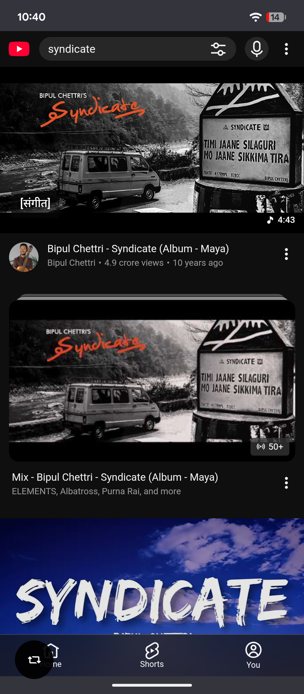
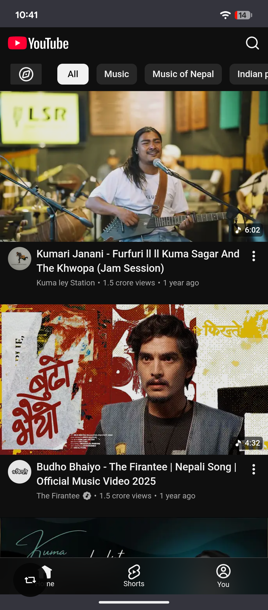
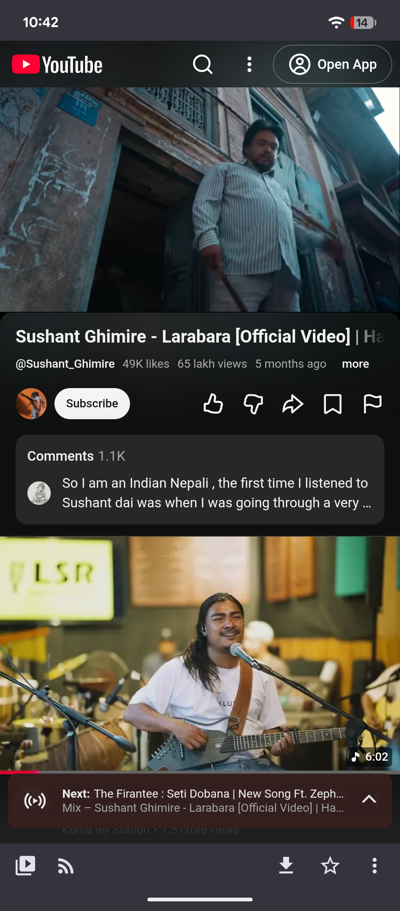
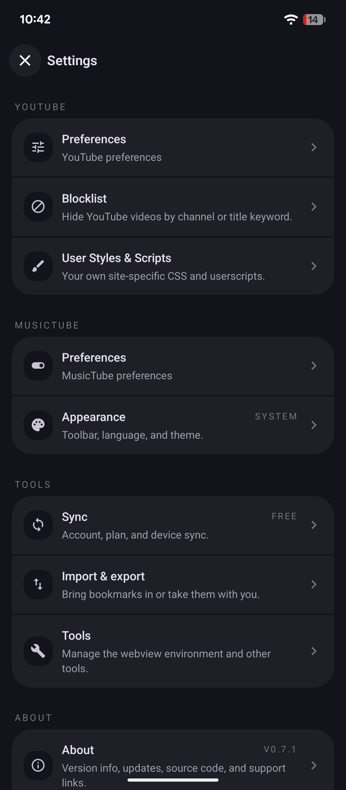

#  MusicTube

Android app for YouTube and YouTube Music — no ads, background play, library management without login.

Download APK from [GitHub Releases](https://github.com/multi-test1/MusicTube/releases/latest).

## Features

- No ads
- Plays in the background
- Manage video/music library without login
- Manage watch history without login
- Download video
- RSS feed reader for YouTube channels
- Hide shorts
- Live chat
- Play original audio
- Customize with CSS

## How it works

- Wrap https://m.youtube.com and https://music.youtube.com in Android webview
- Inject code to block ads
- Hook playback controls and support playing in background

## Screenshots

   

## Contributing

You can find [contributing instructions here](/CONTRIBUTING.md)

## Note

We're not affiliated with any .org websites.
